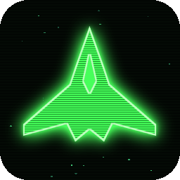

  

# Elite AI Bridge 2.0

Elite AI Bridge is a free, independent Windows companion application for **Elite Dangerous**.
It turns a second screen into a retro command deck: live ship and game information,
one-click flight actions, combat, trade, navigation and colonization tools, an in-game
overlay, a ship voice, and an optional AI co-pilot you talk to with push to talk.

Version 2.0 is a complete redesign of the interface.

This repository holds the full readable source. **To install the Bridge, download the
installer from the [Elite AI Bridge Download releases](https://github.com/CoreDynamicsDev/Elite-AI-Bridge-Download/releases).**
Only download the installer from there.

## What it does
- **Flight Deck:** your ship and shields, hull, fuel, power, key modules, the event log,
  your cargo and full loadout, and the next jumps on your route. Dock, Launch,
  Clear and Jump, and station services are one click each.
- **Combat:** target information, fighter and wing controls, and Bounty Hunting, which
  finds nearby Resource Extraction Sites by danger level.
- **Trade:** route search, a trade loop that plots each next leg, and a trip ledger.
- **Navigation:** follows the route you are flying, with fuel stars and bookmarks.
- **Colonization:** construction progress, what is left to haul, and where to buy it.
- **Commander:** ranks, career totals, this session, and a few odd stats.
- **In-game overlay:** a small click-through panel over Elite (borderless or windowed mode).
- **Ship voice:** spoken alerts and callouts, generated locally on your PC.
- **Setup wizard and guided tours:** every page has a short spoken tour on its ? key.

## AI Co-Pilot and OpenAI
AI features are optional. Everything above works without an OpenAI API key.

If you add the AI co-pilot, you supply your own OpenAI API account and API key.
Elite AI Bridge does not include API service, credits, or an OpenAI subscription.
OpenAI API usage may incur charges billed by OpenAI. Set spending limits on OpenAI's site.

Never share a secret API key, publish it, commit it to GitHub, or include it in screenshots
or support material. See [Privacy and API Keys](PRIVACY_AND_API_KEYS.md).

## Repository layout
- `Elite AI Bridge/` is the application exactly as the installer installs it:
  `frontend/` (PySide6 / QML interface), `backend/` (game, voice and automation engine),
  `assets/`, `docs/`, the runtime setup script and the pinned package lists.
- `Elite_AI_Bridge_Setup.iss` and `BUILD_INSTALLER.bat` build the Windows installer with Inno Setup 6.
- `SHA256SUMS.txt` lists a checksum for every file in the release source.

## Building
See [README_BUILD.txt](README_BUILD.txt). In short: install Inno Setup 6 on Windows and run
`BUILD_INSTALLER.bat`. The installer sets up a private Python runtime on the user's PC with
the exact package versions in `Elite AI Bridge/requirements.txt` and `constraints.txt`.

To run from source on Windows, run `RUN_CURRENT_SOURCE.bat`. On the first run it sets up
the same private runtime the installer uses (internet needed), then starts the Bridge.

## Reporting a bug
In the Bridge, go to Setup > Status. Press MAKE SUPPORT FILE, then REPORT ON GITHUB or
EMAIL IT, and attach the zip. Review a support file before sharing it publicly.

## Support development
**Elite AI Bridge is free to use.** If you enjoy it and want to help support continued
development, voluntary tips are greatly appreciated: **https://ko-fi.com/eliteaibridge**

## License and independence
See [LICENSE.txt](LICENSE.txt), [DISCLAIMER.md](DISCLAIMER.md) and
[THIRD_PARTY_NOTICES.md](THIRD_PARTY_NOTICES.md).

Elite AI Bridge is an independent community-developed companion application. It is not
affiliated with, sponsored by, approved by, or endorsed by Frontier Developments plc or
OpenAI. Elite Dangerous and related names, marks, game content, and intellectual property
belong to Frontier Developments plc and/or their respective rights holders.
